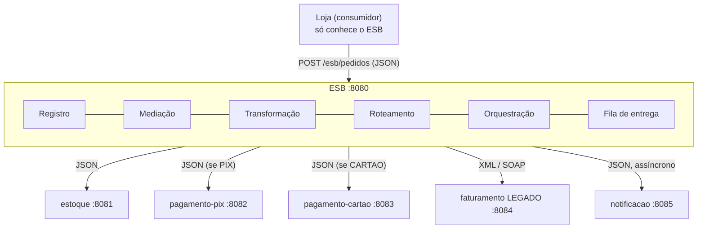
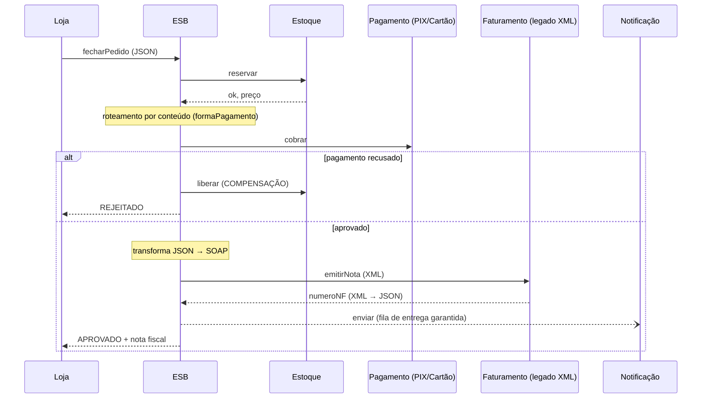

# SOA com ESB (Enterprise Service Bus) em Java

Trabalho da disciplina **Desenvolvimento de Sistemas Distribuídos**, curso de Análise e Desenvolvimento de Sistemas, **Faculdade SENAI FATESG**.

O projeto é uma arquitetura orientada a serviços (SOA) com um **barramento de serviços (ESB) escrito do zero em Java puro**, sem frameworks. Usa só o JDK: `com.sun.net.httpserver`, `java.net.http` e `javax.xml`.

Uma loja virtual fecha pedidos. Para isso precisa de cinco serviços independentes, cada um rodando como um **processo separado**. Um deles é um **sistema legado que só fala XML/SOAP**.

A loja **não conhece nenhum serviço**: só o endereço do barramento. Todo o resto quem faz é o ESB:

| Capacidade do ESB | Classe | O que faz |
|---|---|---|
| Registro de serviços | `esb/ServiceRegistry` | Cada serviço se registra com seu contrato (nome, URL, formato, operações) e manda sinal de vida |
| Mediação / transparência de localização | `esb/ServiceInvoker` | Resolve o nome lógico (`"estoque"`) para o endereço real e faz a chamada |
| Transformação | `esb/Transformer` | JSON canônico ⇄ XML/SOAP, renomeando campos para o vocabulário do legado |
| Roteamento por conteúdo | `esb/ContentBasedRouter` | `formaPagamento = PIX` → `pagamento-pix`; `CARTAO` → `pagamento-cartao` |
| Orquestração com compensação | `esb/Orchestrator` | Processo "Fechar Pedido": estoque → pagamento → nota → notificação; se o pagamento falha, **desfaz a reserva** |
| Entrega garantida | `esb/RetryQueue` | Mensagens assíncronas ficam guardadas e são reenviadas quando o serviço volta |
| Monitoramento | `esb/MessageLog` + `esb/Dashboard` | Cada passo de cada mensagem aparece no terminal e no painel web |

---

## Arquitetura



### Fluxo do processo "Fechar Pedido"



### Exemplo de transformação

A loja manda JSON canônico:

```json
{"pedidoId":"PED-0001","cliente":"Maria","produto":"teclado","quantidade":2,"valor":500}
```

O sistema legado recebe, sem nenhuma alteração no código dele:

```xml
<soap:Envelope xmlns:soap="http://schemas.xmlsoap.org/soap/envelope/" xmlns:fat="http://fatesg.senai.br/faturamento">
  <soap:Body>
    <fat:emitirNota>
      <fat:numeroPedido>PED-0001</fat:numeroPedido>
      <fat:nomeDestinatario>Maria</fat:nomeDestinatario>
      <fat:descricaoItem>teclado</fat:descricaoItem>
      <fat:qtdItens>2</fat:qtdItens>
      <fat:valorTotal>500.00</fat:valorTotal>
    </fat:emitirNota>
  </soap:Body>
</soap:Envelope>
```

---

## Como rodar

Pré-requisito: **JDK 17 ou superior**. Para conferir: `javac -version`.

### Tudo de uma vez (Windows)

Dê dois cliques em **`iniciar.bat`**. Ele:

1. Abre uma janela por processo: ESB, 5 serviços e a loja.
2. Abre o painel do barramento em **http://localhost:8080**.

No Linux/macOS, use `./iniciar.sh` (usa tmux se estiver instalado).

### Um componente por vez

```
run.bat esb
run.bat estoque
run.bat pagamento-pix
run.bat pagamento-cartao
run.bat faturamento
run.bat notificacao
run.bat loja
```

### Em computadores diferentes (opcional)

O ESB roda num notebook e os serviços em outros. Cada serviço informa onde está o barramento e qual IP deve anunciar:

```
run.bat esb
run.bat estoque --esb http://192.168.0.10:8080 --host 192.168.0.11
```

### Comandos da loja

| Comando | Exemplo |
|---|---|
| `comprar <produto> [qtd] [pix\|cartao]` | `comprar teclado 2 pix` |
| `estoque` | consulta os produtos pelo ESB |
| `cliente <nome>` | muda o nome do cliente |
| `sair` | |

Produtos: `teclado` (R$ 250), `mouse` (R$ 90), `monitor` (R$ 1.200), `notebook` (R$ 4.500). O cartão tem limite de R$ 5.000.

O painel web também tem um formulário para fazer pedidos.

---

## Roteiro da demonstração

| # | Ação | O que observar |
|---|---|---|
| 1 | `iniciar.bat` | Os serviços aparecem no painel conforme se **registram** |
| 2 | `comprar teclado 2 pix` | Roteado para **pagamento-pix**; JSON **transformado** em SOAP; o terminal do faturamento mostra o XML; notificação entregue |
| 3 | `comprar notebook 2 cartao` | R$ 9.000 passa do limite: pagamento recusado e **COMPENSAÇÃO** (o estoque libera a reserva) |
| 4 | Fechar a janela da notificação e `comprar mouse 1 pix` | Pedido aprovado mesmo assim; a mensagem **fica na fila** do painel |
| 5 | `run.bat notificacao` | O serviço se registra de novo e a fila **entrega** a mensagem pendente |

---

## SOA com ESB × Microsserviços

| | SOA com ESB (este projeto) | Microsserviços |
|---|---|---|
| Onde fica a inteligência de integração | No **barramento** ("smart pipes") | Nos **serviços** ("smart endpoints, dumb pipes") |
| Comunicação | Tudo passa pelo ESB | Serviço chama serviço (ou via eventos) |
| Formatos | Vários (SOAP, XML, JSON), o ESB traduz | Normalmente um padrão leve (REST/JSON) |
| Foco | Integrar sistemas que já existem, inclusive legados | Construir uma aplicação nova em partes independentes |
| Ponto de atenção | O ESB pode virar gargalo e ponto único de falha | Muitas peças para operar e monitorar |

---

## Estrutura

```
src/main/java/br/senai/fatesg/soa/
├── Main.java              escolhe o componente a rodar
├── common/                Json, Http, Xml, Log (utilitários, só JDK)
├── esb/                   o barramento
├── services/              estoque, pagamento, faturamento (legado), notificação
└── client/LojaClient.java o consumidor
```

## Equipe

| Integrante | Parte do código |
|---|---|
| Joel Felipe dos Santos Gonçalves | `esb/EsbServer`, `esb/Orchestrator`, `esb/ContentBasedRouter`, `esb/RetryQueue`, `Main`, README |
| Gabriel Ribeiro | `common/` (`Json`, `Http`, `Xml`, `Log`), `esb/ServiceRegistry`, `esb/ServiceInvoker`, `esb/Transformer` |
| Luiz Eduardo Pageu Leite | `services/`, `client/LojaClient`, `esb/MessageLog`, `esb/Dashboard`, scripts e `pom.xml` |
